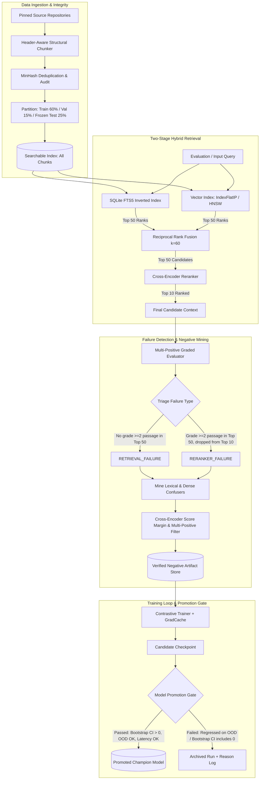

# RAGTune: System Architecture & Component Specification

## 1. System Pipeline Flow

## 2. Hard-Negative Mining & Teacher Score Margin Filtering

### 2.1 Multi-Positive & Same-Chapter Handling
Same-chapter candidates are not excluded en masse; fine-grained technical distinctions (e.g. `READ COMMITTED` vs `REPEATABLE READ`) often reside within the same chapter.

### 2.2 Triage Rules for Candidate Chunks
For a query $q$ with known positive set $D_q^+ = \{ (d_i^+, r_i) \}$:
1. **Known Positive**: If $d \in D_q^+$, it is a ground-truth positive; never mine as negative.
2. **Alternate Valid Evidence**: If $d \notin D_q^+$, but teacher cross-encoder assigns high relevance score $s_{\text{CE}}(q, d) \ge s_{\text{CE}}(q, d_{\text{canonical}}^+) - \Delta_{\text{ambiguity}}$, do not label as negative. Flag for manual review as potential multi-positive.
3. **Near-Duplicate**: If $\text{Jaccard}(d, d^+) > 0.65$, quarantine and exclude.
4. **Verified Hard Negative**: A candidate $d^-$ retrieved by dense or BM25 search is accepted as a hard negative if and only if:
   $$s_{\text{CE}}(q, d_{\text{canonical}}^+) - s_{\text{CE}}(q, d^-) > \Delta_{\text{margin}}$$
   and $d^-$ ranks strictly below all grade $\ge 2$ positives under the cross-encoder teacher.
5. **No Universal Raw Thresholds**: Cross-encoder scores vary widely across architectures. Filtering relies strictly on:
   - Score margin relative to positive: $\Delta_{\text{margin}}$.
   - Rank position relative to known positives.
   - Raw teacher scores are logged as telemetry, not thresholded with arbitrary absolute numbers.
6. **Partition Leakage Prohibition**: Candidates are strictly rejected if the query, positive, or candidate chunk belongs to `frozen_test`. Hard negatives for contrastive training MUST ONLY be mined from queries and passages originating in the `train` source partition. Development failures (from `validation`) may inspire mining heuristics but their evidence chunks never enter training triples directly.

## 3. First-Stage Lexical Engine: SQLite FTS5

- **Specification**: E0 uses SQLite FTS5 exclusively.
- **BM25 Parameters**: SQLite FTS5 implements BM25 using hard-coded parameters $k_1 = 1.2$ and $b = 0.75$ in its internal C rank function; these are immutable at runtime.
- **Deterministic Tokenization**: Configured with the `unicode61` tokenizer, stripping diacritics and lowercasing.
- **Reproducibility**: Improved by pinning the SQLite build, schema, insertion order, tokenizer, and evaluation script.

## 4. Hardware-Conscious Training Architecture

- **Candidate Effective-Batch Range**: 64 to 256 is an effective-batch range to profile using gradient caching.
- Memory fit, throughput, latency, and VRAM usage are treated as unverified hypotheses until measured on hardware via `benchmarks/hardware_profile.py`.
- **Model Revision Pinning**:
  - `BAAI/bge-small-en-v1.5`: Pin exact commit SHA, tokenizer revision, and query instruction configuration.
  - `google/embeddinggemma-300m`: Pin exact revision; handle gated-model authentication explicitly without silent fallback.
  - `Qwen/Qwen3-Embedding-0.6B`: Pin exact revision (zero-shot reference).
